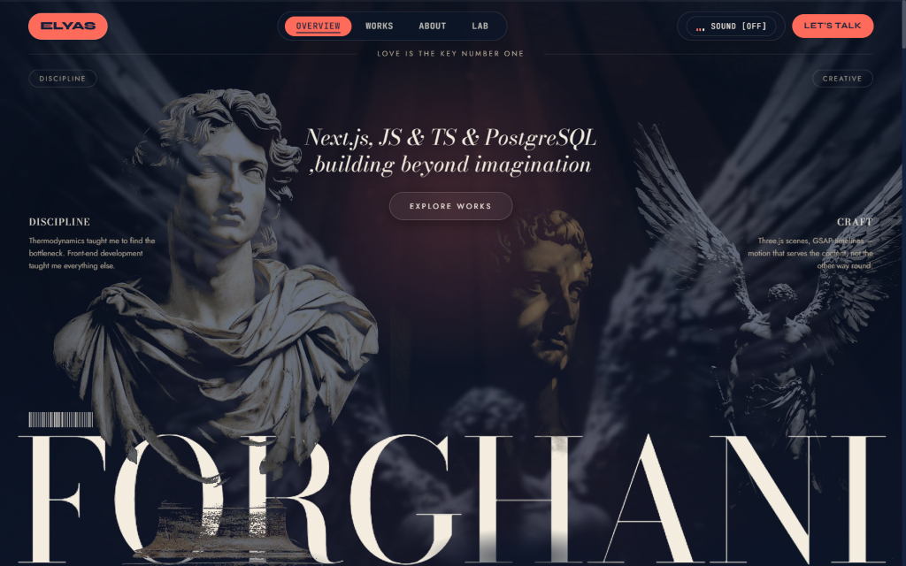
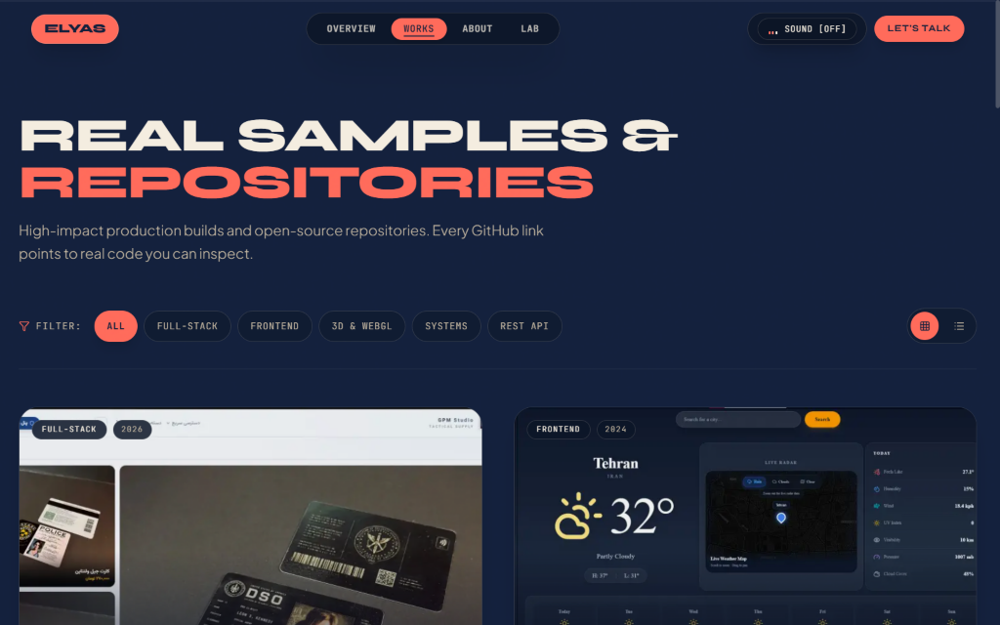
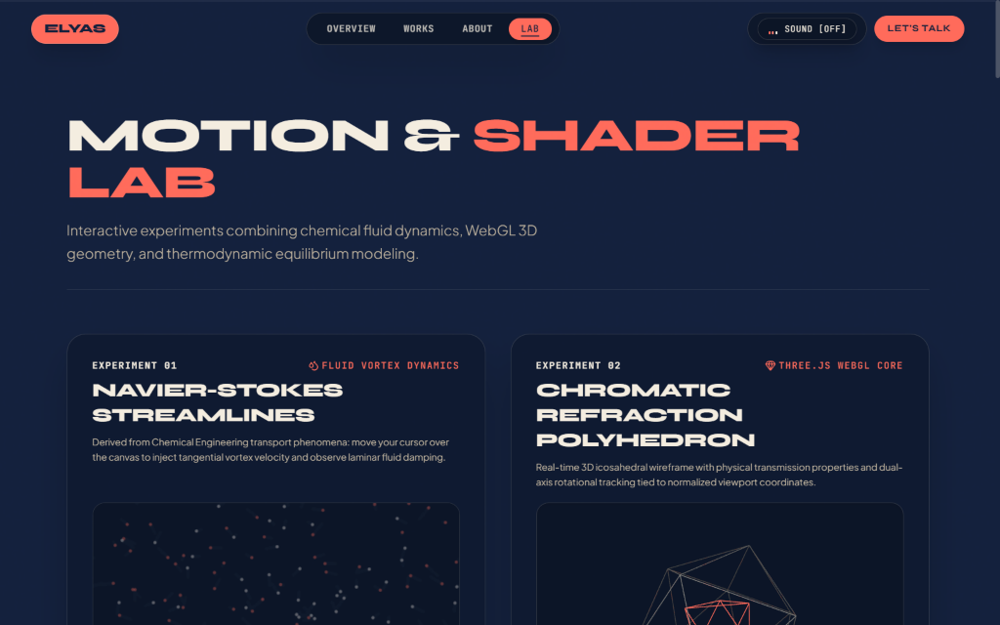

# Elyas Forghani — Creative Developer Portfolio

<div align="center">

[](https://nextjs.org/)
[](https://react.dev/)
[](https://tailwindcss.com/)
[](https://threejs.org/)
[](https://gsap.com/)
[](https://www.w3.org/WAI/standards-guidelines/wcag/)

<p align="center">
  <b>Front-End & Creative Development • Chemical Engineering First Principles • Spatial 3D WebGL</b>
</p>

<p align="center">
  <a href="https://portfolio-git-main-elyasfgi.vercel.app"><strong>🌐 Live Deployment</strong></a> •
  <a href="https://github.com/Elyasforghani/Portfolio"><strong>💻 GitHub Repository</strong></a> •
  <a href="https://civilica.com/doc/1949705/"><strong>📄 Published Research</strong></a>
</p>

</div>

---

## 🪐 Overview

This repository houses the personal portfolio and spatial web realm of **Elyas Forghani** — front-end and creative developer holding a **B.Sc. in Chemical Engineering** from the *University of Kurdistan*. 

The application blends classical aesthetic dioramas with modern computational physics: thermodynamic transport phenomena, real-time WebGL particle dynamics, GSAP-orchestrated ScrollTrigger timelines, and procedural Web Audio API soundscapes — designed without any third-party UI kit, hand-crafted from raw Tailwind CSS v4 and React 19.

> *"My codes have chemistry and love. Handling big projects is my pleasure — building for the web the way I was taught to read a process: find the bottleneck, isolate the resistance, and engineer the equilibrium."*

---

## 📸 Visual Previews

<div align="center">

### 01. Diorama Hero & Overview
<p align="center">
  
</p>

### 02. Curated Works Archive
<p align="center">
  
</p>

### 03. Motion & Shader Lab Experiments
<p align="center">
  
</p>

</div>

---

## 🎨 Design System: The 60 / 30 / 10 Harmony

The entire portfolio adheres strictly to an editorial tri-tone palette:

| Dominance | Role | Hex Code | Visual Tone |
|:---:|:---:|:---:|:---|
| **60%** | Ground & Structural Surfaces | `#14213d` / `#0c1527` / `#0f1a30` | Deep Midnight Navy |
| **30%** | Typography & Secondary Accents | `#f4ede0` / `#c4b7a1` | Warm Architectural Cream |
| **10%** | Focal Points, Indicators & CTAs | `#ff6b5b` / `#ff8577` | Vibrant Energy Coral |

All text, icons, and interactive elements satisfy **WCAG 2.1 AA** minimum contrast (normal text `≥ 4.5:1`, large display text & icons `≥ 3:1`).

---

## ✨ Key Features & Architecture

### 1. Monumental Classical Diorama Hero
- Multi-layer pointer-reactive parallax depth staging Old Masters sculptures (David, Apollo, Hercules, Icarus).
- Real-time grain, viewport lighting, dynamic mouse sway, and silky entry staging.

### 2. Spatial 3D & Physics (Three.js & Canvas)
- **Constellation Field (`ThreeBackground.jsx`)**: Autonomous particle drift with cursor proximity repulsion and dynamic distance-based line connections.
- **Navier-Stokes Fluid Vortex (Experiment 01)**: 2D canvas simulation modeling chemical transport phenomena and circular shear forces.
- **Chromatic Polyhedron (Experiment 02)**: Real-time 3D icosahedral wireframe with physical transmission properties and dual-axis rotational tracking.
- **Thermodynamic System Pipeline (Experiment 03)**: High-concurrency traffic surge and cache-buffer telemetry simulator.
- **Resource Efficiency**: Automatically suspends `requestAnimationFrame` render loops via `IntersectionObserver` and `document.hidden` when scrolled out of view or tabbed away.

### 3. Motion & Inertial Scroll Choreography
- **Lenis Smooth Scroll**: Inertial wheel scrolling synced to GSAP's internal ticker.
- **GSAP ScrollTrigger**: Pinned horizontal galleries, masked typography splits, and staggered metric cards.
- **Reduced Motion Guardian**: Full compliance with `prefers-reduced-motion: reduce` — transforms, pins, and loops gracefully revert to accessible instant final states (`opacity: 1`).

### 4. Interactive Telemetry & Command Tools
- **Developer CLI Terminal (`` ` ``)**: Built-in zsh-style modal terminal with runnable commands (`bio`, `research`, `stack`, `projects`, `matrix`, `contact`).
- **Command Teleport Palette (`Ctrl+K` / `⌘K`)**: Fuzzy keyboard navigation across all sections, routes, and external artifacts.
- **Native `<dialog>` Architecture**: Top-layer modal focus traps, `showModal()` lifecycle, and `closedby="any"` light-dismiss without page-shift scrollbar locking.

### 5. Procedural Web Audio Engine
- Ambient generative soundscapes synthesized entirely via the browser's native **Web Audio API** — no heavy external audio files required. Real-time animated frequency visualizer with persistent mute state.

---

## 🗺️ Routes & Pages

| Route | Title | Description |
|:---|:---|:---|
| [`/`](src/app/page.jsx) | **Overview** | Diorama hero, manifesto narrative, top projects, engineering bento, philosophy, and kinetic collaboration CTA. |
| [`/works`](src/app/works/page.jsx) | **Works Archive** | Interactive filterable catalog of production builds and open-source repos with both Grid and Editorial List views. |
| [`/works/[slug]`](src/app/works/[slug]/page.jsx) | **Case Studies** | Deep-dive architectural breakdowns, layer matrices, tech tags, and direct GitHub links. |
| [`/about`](src/app/about/page.jsx) | **Trajectory** | The complete transition story from Kurdistan chemical labs and control rooms to high-performance web development. |
| [`/lab`](src/app/lab/page.jsx) | **Motion & Shader Lab** | Interactive sandbox hosting fluid vortex simulations, WebGL polyhedron crystals, and pipeline telemetry. |
| [`/_not-found`](src/app/not-found.jsx) | **Spatial Void** | Custom 404 screen with orbital coordinates and one-click teleport return. |

---

## 💼 Featured Projects

Every project listed below corresponds to genuine, inspectable source code on [GitHub](https://github.com/Elyasforghani) or live client infrastructure:

| Project | Stack | Focus | Links |
|:---|:---|:---|:---:|
| **GPM Studio** | Next.js, React, Tailwind CSS | Client production storefront for gaming collectibles, cards & posters (Bilingual RTL) | [Live Site](https://gpm-studio.com) |
| **Weather Forecast App** | JavaScript, Weather API, CSS Grid | Real-time atmospheric conditions, async API fetch pipeline & adaptive condition cards | [Repo](https://github.com/Elyasforghani/Weather) • [Demo](https://elyasforghani.github.io/Weather) |
| **Parallax Portfolio** | Next.js 16, Three.js, GSAP 3, Lenis | This very site — creative coding, 3D WebGL particle constellation & ambient audio | [Repo](https://github.com/Elyasforghani/Portfolio) • [Demo](https://portfolio-git-main-elyasfgi.vercel.app) |
| **Hope Church** | Tailwind CSS, HTML5, JavaScript | Warm, accessible responsive community portal with service times & sermon library | [Repo](https://github.com/Elyasforghani/hopechurch-tailwind) • [Demo](https://elyasforghani.github.io/hopechurch-tailwind) |
| **Hotel Abbasi Showcase** | Tailwind CSS, Swiper.js, JS | Luxury Iranian architectural showcase for Isfahan's historic heritage hotel | [Repo](https://github.com/Elyasforghani/hotelabbasi-tailwindproject) • [Demo](https://elyasforghani.github.io/hotelabbasi-tailwindproject) |
| **Password Strength Meter** | Vanilla JavaScript, RegEx | Client-side heuristic regex engine rating password entropy and variety in real time | [Repo](https://github.com/Elyasforghani/password-strength-check) • [Demo](https://elyasforghani.github.io/password-strength-check) |
| **User Management CRUD** | Next.js 15, React Hook Form, MockAPI | Dark glassmorphic admin dashboard with full CRUD flow, validation & Three.js starfield | [Repo](https://github.com/Elyasforghani/NextJs-Usermanagement) |
| **Two-Player Dice Game** | Vanilla JavaScript ES6+, DOM | Turn-based risk engine, banked scores and keyframe dice animations — zero dependencies | [Repo](https://github.com/Elyasforghani/dice-game) • [Demo](https://elyasforghani.github.io/dice-game) |

---

## 🔬 Published Academic Research

- **Title**: *Photocatalytic Degradation of Tetracycline Using ZnO Nanoparticles Supported in a Y-Zeolite Matrix*
- **Conference**: 9th International Conference on Chemical Engineering (*OGPCONF09_037*)
- **Author**: Elyas Forghani
- **Permanent Record**: [Civilica Document #1949705](https://civilica.com/doc/1949705/)
- **Core takeaway**: Catalytic kinetics, mass-balance rigor, and chemical equilibrium modeling form the foundational thinking applied to distributed systems, caching, and state management today.

---

## ⌨️ Global Keyboard Controls

| Key Shortcut | Action |
|:---:|:---|
| <kbd>`</kbd> *(Backtick / Tilde)* | Toggle the **Developer CLI Terminal** |
| <kbd>Ctrl</kbd> + <kbd>K</kbd> / <kbd>⌘</kbd> + <kbd>K</kbd> | Open the **Command Teleport Palette** |
| <kbd>Esc</kbd> | Dismiss any open modal dialog or drawer |
| <kbd>Tab</kbd> | Reveal the accessible **Skip to main content** link |
| <kbd>↑</kbd> <kbd>↓</kbd> <kbd>Enter</kbd> | Navigate and select options in the Command Palette |

---

## 🛠️ Tech Stack & Dependencies

```
para/
├── Next.js 16.3.4 (App Router & Turbopack)
├── React 19.2.8 & React DOM 19.2.8
├── Tailwind CSS v4.0 (@tailwindcss/postcss)
├── Three.js (WebGL rendering, buffer geometry, physical shaders)
├── GSAP 3.15 + @gsap/react (ScrollTrigger timelines & ticker)
├── Lenis 1.3 (Smooth inertial scrolling)
├── Lucide React (Accessible SVG iconography)
└── @fontsource-variable (Syne, Space Grotesk, Plus Jakarta Sans, Cinzel, JetBrains Mono)
```

---

## 🚀 Getting Started

### Prerequisites
- **Node.js**: `v20.x` or later recommended
- **npm**, **pnpm**, or **yarn**

### Installation

```bash
# Clone the repository
git clone https://github.com/Elyasforghani/Portfolio.git

# Enter project directory
cd Portfolio

# Install dependencies
npm install

# Start development server with Turbopack
npm run dev
```

Visit [`http://localhost:3000`](http://localhost:3000) in your browser.

### Production Build

```bash
# Run ESLint validation
npm run lint

# Generate optimized static & SSG production bundle
npm run build

# Preview production build locally
npm run start
```

---

## 📬 Contact & Coordinates

- **Developer**: Elyas Forghani
- **Email**: [elyasfgidev@gmail.com](mailto:elyasfgidev@gmail.com)
- **GitHub**: [@Elyasforghani](https://github.com/Elyasforghani)
- **LinkedIn**: [Elyas Forghani](https://www.linkedin.com/in/elyas-forghani-b4746b263/)
- **Instagram**: [@elyasforghani.dev](https://www.instagram.com/elyasforghani.dev)
- **Location**: Tehran, Iran (Available for remote front-end / full-stack engineering roles worldwide)

---

<div align="center">
  <sub>Handcrafted with Next.js, Three.js, GSAP, and chemical precision. &copy; 2026 Elyas Forghani. All rights reserved.</sub>
</div>
